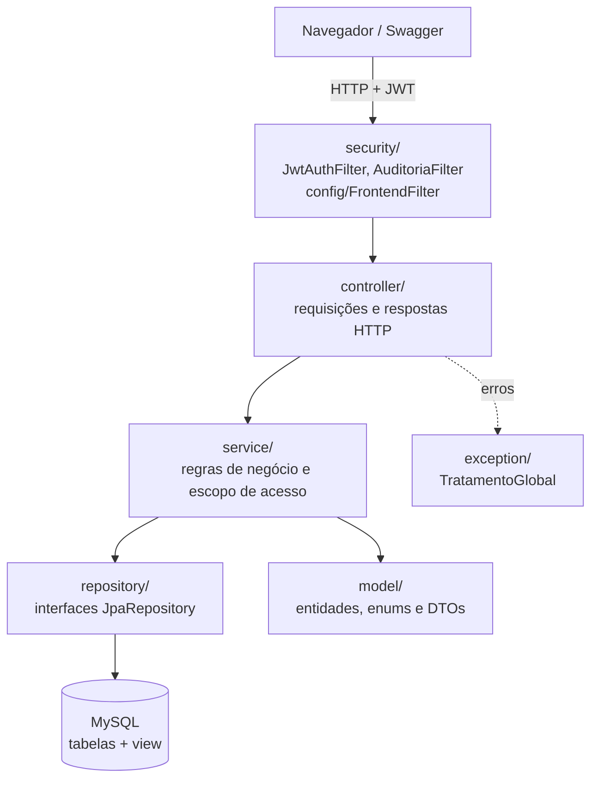
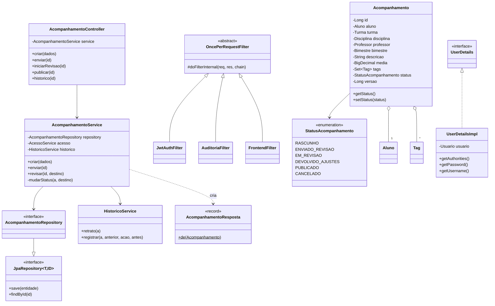

# Entrega 2 — Programação Orientada a Objetos
## KFKA – Plataforma de Acompanhamento Escolar

**Integrantes:** Ana Julia Bernardo Quintans, Riane Toscano, Ricardo Branco Rios

**Objetivo da entrega:** subir o backend do projeto, garantindo que o sistema esteja
disponível e acessível em **servidor local (localhost)** e **na nuvem**, com o serviço
de backend configurado e a conexão com o banco de dados MySQL funcionando.

| Ambiente | Endereço | Situação |
| --- | --- | --- |
| ☁️ Nuvem (Railway) | https://app-production-aedab.up.railway.app | Telas + API + MySQL em produção |
| ☁️ API na nuvem | https://app-production-aedab.up.railway.app/status · [Swagger](https://app-production-aedab.up.railway.app/swagger-ui/index.html) | `{"status":"UP"}` |
| 💻 Servidor local | http://localhost:8080 (API) · http://localhost:5173 (telas) | Instruções na seção 5 |

### 🔑 Acesso para teste (nuvem)

Entre em https://app-production-aedab.up.railway.app com um dos logins abaixo.
Os dados são fictícios e já estão preparados para testar o fluxo completo.

| Perfil | E-mail | Senha | O que testar |
| --- | --- | --- | --- |
| Administrador | `admin@kfka.com` | `Kfka863b8ac9a944!` | Cadastros (Pessoas, Estrutura escolar); fila de revisão com o acompanhamento de Matemática do Lucas para revisar, devolver ou publicar; relatórios e exportação |
| Professor(a) | `professor@kfka.com` | `Professor@2026` | Beatriz Santos, turma 5º A (Português e Matemática): ver acompanhamentos, editar o rascunho da Sofia e enviar para revisão, criar novos |
| Responsável | `responsavel@kfka.com` | `Responsavel@2026` | Maria Oliveira, mãe do Lucas: ver o acompanhamento publicado de Português, registrar ciência e baixar o PDF |

Situação inicial dos acompanhamentos (4º bimestre de 2026, aberto até 31/12/2026):

| Aluno | Disciplina | Média | Status |
| --- | --- | --- | --- |
| Lucas Oliveira | Língua Portuguesa | 8,5 | Publicado |
| Lucas Oliveira | Matemática | 7,0 | Enviado para revisão |
| Sofia Lima | Língua Portuguesa | 9,0 | Rascunho |

Os mesmos logins funcionam no
[Swagger](https://app-production-aedab.up.railway.app/swagger-ui/index.html)
(`POST /usuarios/logar` → botão **Authorize** com o token). Os dados de demonstração
foram criados pelo script [`scripts/dados-demo.sh`](../../../src/Entrega%202/Backend/scripts/dados-demo.sh).

Código-fonte:
- Backend: [`src/Entrega 2/Backend`](../../../src/Entrega%202/Backend) — Java 17 + Spring Boot 3.5
- Frontend: [`src/Entrega 2/Frontend`](../../../src/Entrega%202/Frontend) — React + TypeScript + Vite

---

## 1. Classe principal: `KfkaApplication`

Arquivo: [`br/com/kfka/KfkaApplication.java`](../../../src/Entrega%202/Backend/src/main/java/br/com/kfka/KfkaApplication.java)

```java
@SpringBootApplication
public class KfkaApplication {
    public static void main(String[] args) {
        SpringApplication.run(KfkaApplication.class, args);
    }
}
```

Ao executar `SpringApplication.run(...)`, o sistema sobe sempre na mesma ordem:

1. **Lê a configuração** de `application.properties` e do perfil ativo (`dev` local ou
   `prod` na nuvem). Senhas e endereços vêm de **variáveis de ambiente**, nunca do código.
2. **Conecta ao MySQL** (`spring.datasource.*` = `DB_URL`, `DB_USERNAME`, `DB_PASSWORD`) e
   o Hibernate confere se as tabelas correspondem às entidades. Em `prod` usa
   `ddl-auto=validate`: se o banco estiver diferente das classes, o sistema **não sobe**.
3. **Cria os objetos** de cada camada (`@Repository`, `@Service`, `@RestController`) e
   injeta as dependências entre eles.
4. **Monta a segurança**: `SecurityConfig` registra o filtro JWT, a auditoria, o CORS e
   as permissões de cada perfil (Administrador, Professor e Responsável).
5. **Cria o administrador inicial** (`AdministradorInicial`), apenas nos perfis `dev` ou
   `bootstrap` e somente se ainda não existir nenhum administrador.
6. **Sobe o servidor HTTP** (Tomcat) na porta `PORT` (padrão 8080).

**Novidade da Entrega 2:** o frontend React passa a ser empacotado dentro do backend
para o deploy na nuvem. A classe `FrontendFilter` entrega as telas em `/` e a API em
`/api/...`, deixando o sistema inteiro em **um único endereço**.

---

## 2. Arquitetura em camadas



| Camada | Pacote | Classes | Exemplos |
| --- | --- | --- | --- |
| Inicialização | `br.com.kfka` | 1 | `KfkaApplication` |
| Configuração | `config` | 6 | `AdministradorInicial`, `FrontendFilter`, `SwaggerConfig`, `SenhaConfig` |
| Segurança | `security` | 7 | `SecurityConfig`, `JwtService`, `JwtAuthFilter`, `UserDetailsImpl` |
| Requisições HTTP | `controller` | 18 | `AcompanhamentoController`, `AlunoController`, `PdfController` |
| Regras de negócio | `service` | 12 | `AcompanhamentoService`, `AcessoService`, `HistoricoService`, `PdfService` |
| Acesso a dados | `repository` | 16 | `AcompanhamentoRepository`, `AlunoRepository`, `UsuarioRepository` |
| Entidades e DTOs | `model` | 35 | `Acompanhamento`, `Aluno`, `Bimestre`, `Usuario`, `StatusAcompanhamento` |
| Erros | `exception` | 2 | `TratamentoGlobal`, `ErroResposta` |

### Diagrama das classes principais



---

## 3. Conceitos de POO aplicados

**Encapsulamento.** Todos os atributos das entidades são `private` e acessados por
getters/setters (ex.: `Acompanhamento`, `Aluno`, `Bimestre`). O campo `senha` de `Usuario`
é marcado como `WRITE_ONLY`, então nunca sai nas respostas JSON. A mudança de status do
acompanhamento só acontece dentro de `AcompanhamentoService.mudarStatus(...)`, método
privado que também grava o histórico, de modo que nenhuma outra classe consegue alterar o
status sem deixar rastro.

**Abstração.** Os repositories são apenas **interfaces** que estendem `JpaRepository`;
o código não escreve SQL para salvar, buscar ou listar. Os controllers só conhecem os
services, e os services não conhecem HTTP. Por exemplo, `AcompanhamentoController.publicar()`
apenas chama `service.revisar(id, PUBLICADO)`.

**Herança.** `JwtAuthFilter`, `AuditoriaFilter` e `FrontendFilter` herdam de
`OncePerRequestFilter` (Spring) e sobrescrevem `doFilterInternal(...)`. A classe-mãe garante
que o filtro rode uma única vez por requisição; cada filha implementa só a sua parte
(validar o token, registrar auditoria ou servir as telas). Os repositories herdam de
`JpaRepository` os métodos `save`, `findById`, `findAll` etc.

```java
public class JwtAuthFilter extends OncePerRequestFilter {
    @Override
    protected void doFilterInternal(HttpServletRequest request, HttpServletResponse response,
                                    FilterChain chain) throws ServletException, IOException { ... }
}
```

**Polimorfismo.** `UserDetailsImpl` implementa a interface `UserDetails`: o Spring Security
chama `getAuthorities()`, `getPassword()` e `isEnabled()` sem saber que, por trás, existe um
`Usuario` do KFKA. Da mesma forma, a cadeia de segurança trata os três filtros como
`OncePerRequestFilter`, e cada um responde de um jeito diferente ao mesmo método.

**Enum como máquina de estados.** `StatusAcompanhamento` define os estados possíveis, e
`AcompanhamentoService.revisar(...)` usa um `switch` sobre o enum para decidir quais
transições são válidas:

```java
boolean permitido = switch (destino) {
    case EM_REVISAO -> a.getStatus() == StatusAcompanhamento.ENVIADO_REVISAO;
    case PUBLICADO, DEVOLVIDO_AJUSTES -> a.getStatus() == StatusAcompanhamento.EM_REVISAO;
    case CANCELADO -> a.getStatus() != StatusAcompanhamento.PUBLICADO
                   && a.getStatus() != StatusAcompanhamento.CANCELADO;
    default -> false;
};
```

`PerfilUsuario` (ADMINISTRADOR, PROFESSOR, RESPONSAVEL) é usado da mesma forma para as
permissões.

**Composição e associação.** `Acompanhamento` é composto por objetos de outras classes:
`Aluno`, `Turma`, `Disciplina`, `Professor`, `Bimestre` e um conjunto de `Tag`
(`@ManyToOne` / `@ManyToMany`). `Professor` e `Responsavel` são associados a um `Usuario`
(`@OneToOne`).

**Objetos imutáveis (records).** Os dados de entrada e saída da API são `record`s
imutáveis, como `AcompanhamentoCadastro`, `AcompanhamentoEdicao`, `UsuarioLoginResposta` e
`AcompanhamentoResposta`. O método de fábrica estático `AcompanhamentoResposta.de(a)` converte
a entidade em resposta, expondo apenas o resumo do professor (id e nome).

**Injeção de dependência.** Nenhuma classe cria suas dependências com `new`: o Spring
injeta os repositories nos services e os services nos controllers (por construtor, como em
`AcompanhamentoController(AcompanhamentoService service)`, ou por `@Autowired`). Isso deixa o
código desacoplado e permite testar com outro banco (H2 nos testes).

**Tratamento de exceções centralizado.** Os services lançam `ResponseStatusException` com
o código HTTP e a mensagem; a classe `TratamentoGlobal` (`@RestControllerAdvice`) captura
as exceções e devolve sempre o mesmo formato (`ErroResposta`), sem expor detalhes internos.

**Responsabilidade única.** `JwtService` só gera e valida tokens; `PdfService` só monta o
PDF; `HistoricoService` só registra o antes/depois; `AcessoService` só decide o que cada
usuário pode ver.

---

## 4. Conexão com o banco de dados

- Banco **MySQL 8**, acessado via **Spring Data JPA / Hibernate** com o driver
  `mysql-connector-j`.
- A conexão é configurada em `application.properties` por variáveis de ambiente:

  ```properties
  spring.datasource.url=${DB_URL}
  spring.datasource.username=${DB_USERNAME}
  spring.datasource.password=${DB_PASSWORD}
  ```

- O schema é criado pelos scripts [`sql/01_schema.sql`](../../../src/Entrega%202/Backend/sql/01_schema.sql)
  (18 tabelas, chaves estrangeiras e índices) e
  [`sql/02_view_relatorios.sql`](../../../src/Entrega%202/Backend/sql/02_view_relatorios.sql)
  (view `vw_acompanhamentos_publicados`, sem e-mails nem senhas).
- Local: banco `kfka` com um usuário MySQL dedicado (`kfka`), sem usar o `root`.
- Nuvem: serviço MySQL do Railway, ligado ao backend pela rede privada do Railway.
- Senhas são guardadas com **BCrypt**, e o arquivo `.env` com as credenciais **não** é
  versionado.

---

## 5. Como executar em servidor local (localhost)

**Pré-requisitos:** JDK 17, MySQL 8 em execução e Node.js 22+ (para as telas).

```sh
# 1) Banco (uma única vez), dentro de src/Entrega 2/Backend
mysql -u root -p -e "CREATE DATABASE kfka CHARACTER SET utf8mb4;"
mysql -u root -p kfka < sql/01_schema.sql
mysql -u root -p kfka < sql/02_view_relatorios.sql

# 2) Backend
cp .env.example .env          # preencha DB_URL, DB_USERNAME, DB_PASSWORD, JWT_SECRET, ADMIN_*
set -a; . ./.env; set +a
./mvnw spring-boot:run        # no Windows/PowerShell: mvnw.cmd spring-boot:run

# 3) Frontend (outro terminal), dentro de src/Entrega 2/Frontend
pnpm install
pnpm dev
```

Ao subir, o terminal mostra:

```
Tomcat started on port 8080 (http) with context path '/'
Started KfkaApplication in 3.6 seconds
```

| Endereço | Resultado |
| --- | --- |
| http://localhost:8080/status | `{"status":"UP"}` |
| http://localhost:8080/swagger-ui/index.html | Documentação interativa da API |
| http://localhost:5173 | Tela de login |

---

## 6. Como está publicado na nuvem (Railway)

- Um projeto no Railway com **dois serviços**: **MySQL** (gerenciado) e **App**.
- O App é construído pelo [`Dockerfile`](../../../src/Entrega%202/Dockerfile) de
  `src/Entrega 2`, em três etapas:
  1. compila o frontend React (`pnpm build`);
  2. copia as telas para `src/main/resources/static` e gera o `.jar` com Maven;
  3. executa o `.jar` em uma imagem Java 17 enxuta, com usuário sem privilégios.
- As credenciais do banco chegam ao backend por **variáveis de referência** do Railway
  (`${{MySQL.MYSQLHOST}}`, `${{MySQL.MYSQLPASSWORD}}`...), nunca pelo código.
- O perfil `prod` valida o schema (`ddl-auto=validate`) e exige `CORS_ORIGINS` explícito.
- O health check do Railway consulta `/status`.
- Telas e API ficam no **mesmo endereço**: `/` (telas), `/api/...` (API) e
  `/swagger-ui/index.html` (documentação).
- Como o repositório pertence à organização da faculdade, o código foi enviado ao Railway
  pela **Railway CLI** (`railway up`), a partir da pasta `src/Entrega 2`.

Verificação feita em 09/11/2026 no endereço publicado:

```
GET  /status                    -> {"status":"UP"}
GET  /  (navegador)             -> tela de login do KFKA
GET  /swagger-ui/index.html     -> 200
GET  /api/alunos  (sem token)   -> 401
POST /api/usuarios/logar        -> token JWT do administrador
POST /api/areas                 -> {"id":1,"nome":"Linguagens","ativo":true}  (gravado no MySQL do Railway)
Log: The following 1 profile is active: "prod" · Started KfkaApplication in 5.5 seconds
```

O passo a passo completo está no README do [backend](../../../src/Entrega%202/Backend/README.md).

---

## 7. Evidências: fluxo de ponta a ponta executado em localhost

Teste feito em 09/11/2026 com o backend rodando em `http://localhost:8080` sobre o MySQL 8.0
local, chamando a API pelo prefixo `/api` (o mesmo usado pelas telas):

```
== 0. API no ar: {"status":"UP"}
== 1. Administrador faz login -> token JWT recebido
== Segurança: sem token -> 401
== 2. Cadastros: usuário professor=2, usuário responsável=3, professor=1, aluno=1, responsável=1
== 3. Estrutura: área=1, disciplina=1, turma=1, matrícula=1, vínculo=1, bimestre=1 (4º/2026), tag=1
== Segurança: professor em rota de administrador -> 403
== 4. Professor salva rascunho:
   {"id":1,"aluno":"Lucas Oliveira","disciplina":"Língua Portuguesa","media":8.5,
    "status":"RASCUNHO","tags":["Ótimo desempenho"]}
== 5. Professor envia para revisão -> ENVIADO_REVISAO
== Regra: publicar sem revisão -> 409 "Transição de ENVIADO_REVISAO para PUBLICADO não permitida"
== 6. Administrador inicia revisão -> EM_REVISAO
== 7. Administrador publica -> PUBLICADO
   histórico: CRIACAO -> STATUS_ENVIADO_REVISAO -> STATUS_EM_REVISAO -> STATUS_PUBLICADO
== 8. Responsável vê seus alunos: ["Lucas Oliveira"]
   acompanhamentos publicados do aluno: [{"id":1,"disciplina":"Língua Portuguesa","media":8.50,"status":"PUBLICADO"}]
== 9. Responsável registra ciência -> {"id":1,"acompanhamentoId":1,"dataHoraCiencia":"2026-11-09T19:46:19"}
   segunda ciência -> 409
== 10. PDF: HTTP 200, application/pdf, 9878 bytes
== 11. CSV: HTTP 200, text/csv;charset=UTF-8, 271 bytes
```

O registro publicado aparece no MySQL pela view de relatórios:

```
mysql> SELECT * FROM vw_acompanhamentos_publicados\G
acompanhamento_id: 1
       aluno_nome: Lucas Oliveira
       turma_nome: 5º A
  bimestre_numero: 4
  disciplina_nome: Língua Portuguesa
        area_nome: Linguagens
   professor_nome: Professora Beatriz Santos
        descricao: Lucas evoluiu na leitura e na produção de textos.
            media: 8.50
   total_ciencias: 1
```

Isso cobre o fluxo principal do projeto: *Administrador configura turma, disciplina e
bimestre → Professor registra e envia → Administrador revisa e publica → Responsável
consulta, registra ciência e baixa o PDF → Administrador exporta o relatório*.

Além disso, a suíte automatizada do backend (`./mvnw test`) executa **20 testes sem
falhas**, cobrindo login, permissões por perfil, fluxo de revisão, histórico, ciência, PDF,
CSV e a validação do schema SQL.
